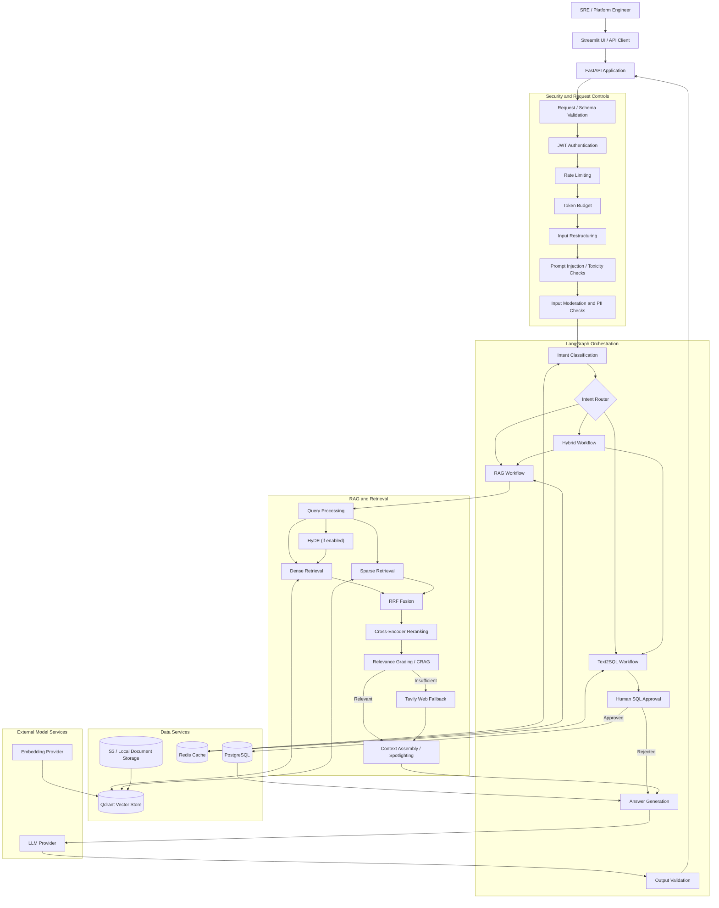
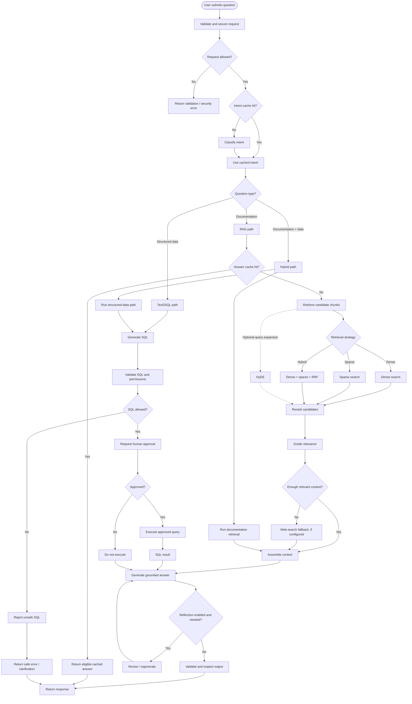
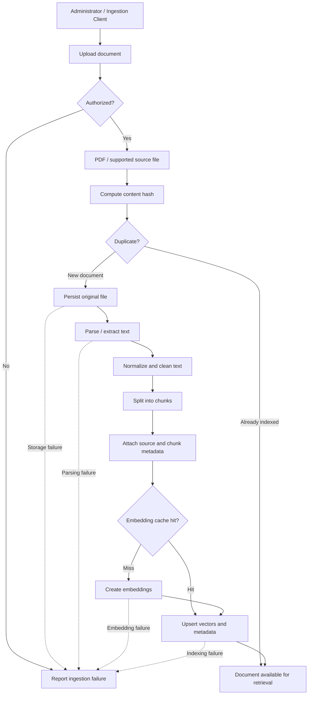
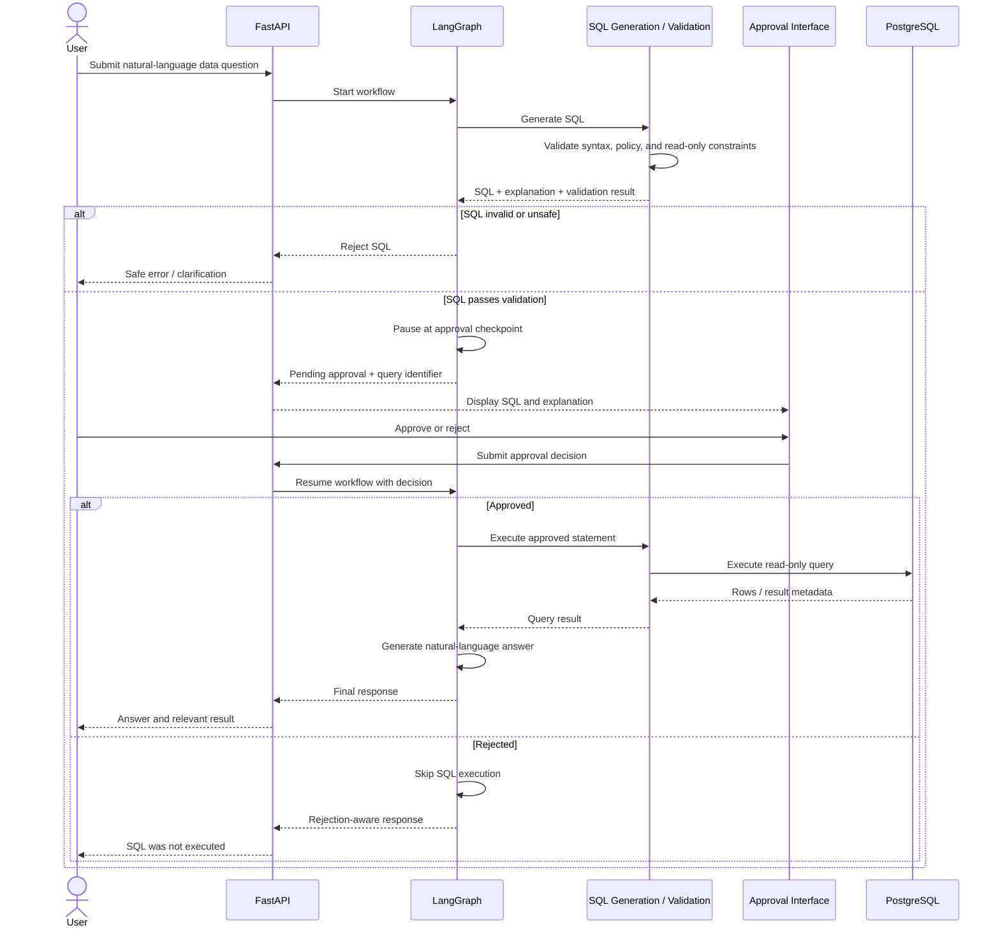
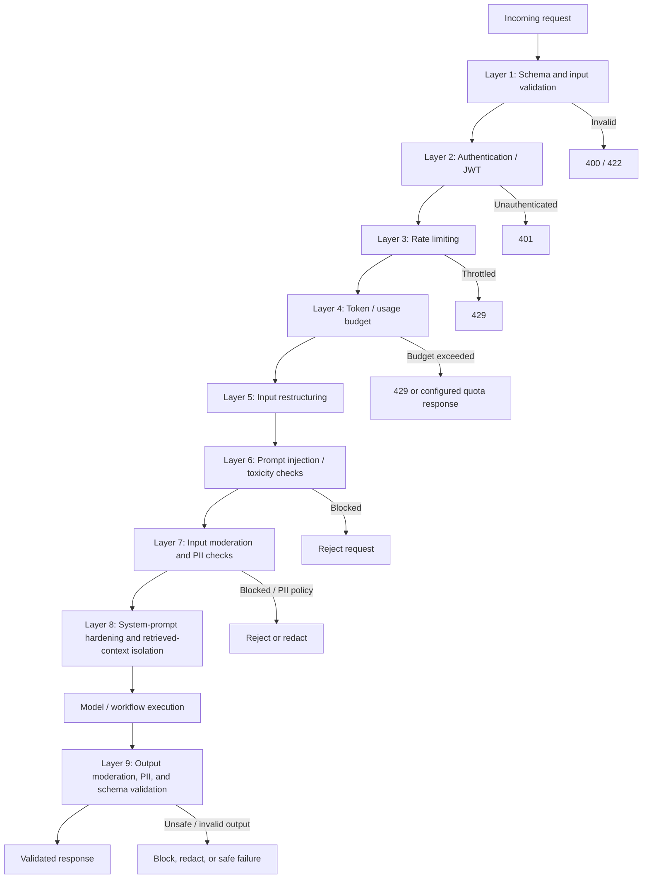
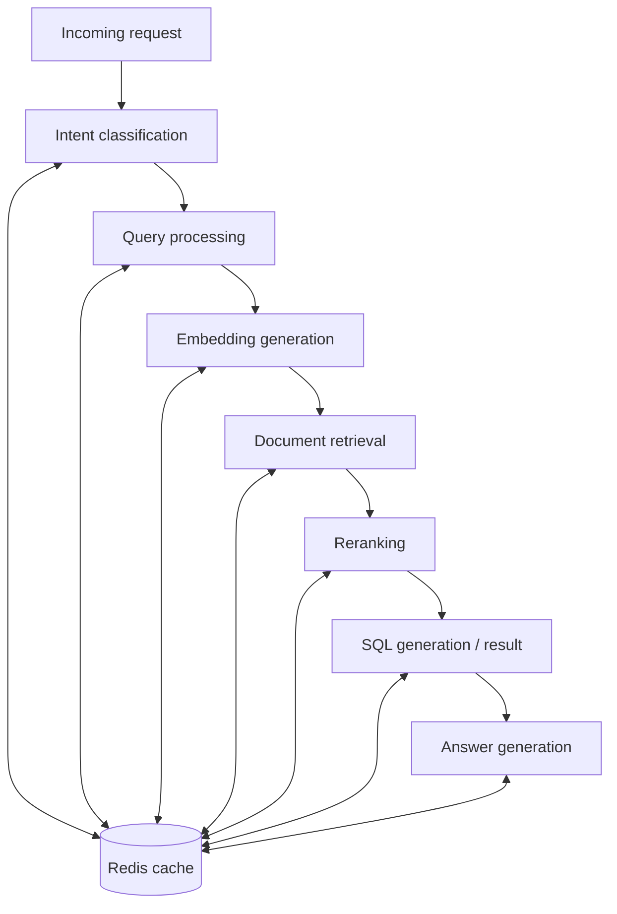
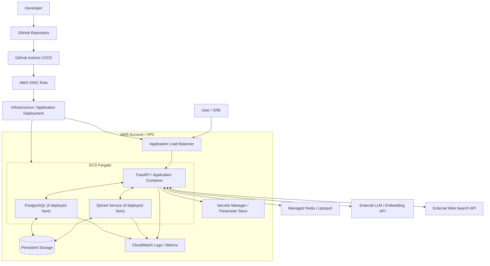

# ENTERPRISERAG_LIVE — Enterprise Architecture & Scenario Design

> **Purpose:** Project-level architecture documentation for the Enterprise Kubernetes RAG + Text2SQL IT Operations Copilot.
>
> **Repository:** https://github.com/ramboorgadda/ENTERPRISERAG_LIVE
>
> **Status:** Architecture reference derived from the repository's documented design. Verify component names, routes, configuration flags, and runtime behavior against the implementation before treating every flow as production behavior.

---

## Table of contents

1. [System overview](#1-system-overview)
2. [Enterprise architecture](#2-enterprise-architecture)
3. [Query orchestration and scenarios](#3-query-orchestration-and-scenarios)
4. [Document ingestion lifecycle](#4-document-ingestion-lifecycle)
5. [Text2SQL human approval](#5-text2sql-human-approval)
6. [Security architecture](#6-security-architecture)
7. [Caching architecture](#7-caching-architecture)
8. [Deployment architecture](#8-deployment-architecture)
9. [Scenario coverage matrix](#9-scenario-coverage-matrix)
10. [Operational and production considerations](#10-operational-and-production-considerations)
11. [Implementation verification checklist](#11-implementation-verification-checklist)

---

## 1. System overview

ENTERPRISERAG_LIVE is designed as an enterprise IT operations copilot that combines retrieval-augmented generation (RAG), natural-language-to-SQL (Text2SQL), and hybrid question answering.

The documented design includes:

- Dense and sparse retrieval with reciprocal-rank fusion (RRF).
- Query enhancement techniques such as HyDE.
- Cross-encoder reranking and relevance grading.
- Corrective retrieval / web-search fallback.
- Self-reflection or answer-improvement loops where enabled.
- Text2SQL with a human approval checkpoint.
- Hybrid workflows that combine retrieved documentation and structured database results.
- Redis-backed caching.
- Layered request and response security controls.
- Document ingestion, parsing, chunking, embedding, and vector indexing.
- External AI and web-search services.
- Containerized deployment on AWS.

### High-level capabilities

| Capability | Purpose |
|---|---|
| RAG | Answer questions from indexed enterprise documentation |
| Text2SQL | Translate approved natural-language questions into read-only SQL |
| Hybrid QA | Combine documentation context with structured operational data |
| Ingestion | Turn source documents into searchable chunks and vectors |
| Caching | Reduce repeated computation and external service calls |
| Security | Validate, authenticate, constrain, and inspect requests and responses |
| Evaluation | Measure answer quality and retrieval behavior |

---

## 2. Enterprise architecture

**Reading the diagram:** A request passes through the API and configured security controls, is classified and routed, then uses RAG, Text2SQL, or both. Retrieved context and/or approved SQL results are used to produce a response. The exact ordering and optional branches should be checked against the implemented graph.

---

## 3. Query orchestration and scenarios

This flow describes the principal user-query paths and common decision points.

### Scenario notes

| Scenario | Expected design behavior |
|---|---|
| Documentation question | Retrieve relevant indexed chunks and generate a grounded answer |
| Structured-data question | Generate SQL, validate it, request approval, then execute only if approved |
| Hybrid question | Coordinate retrieval and SQL branches, then synthesize both result sets |
| Dense retrieval | Find semantically similar chunks |
| Sparse retrieval | Find keyword or lexical matches |
| Hybrid retrieval | Combine rankings, for example with RRF |
| HyDE enabled | Generate a hypothetical retrieval aid before searching |
| Reranking enabled | Reorder candidates by query relevance |
| Low relevance | Use configured corrective retrieval or web fallback |
| Cache hit | Reuse a valid cached result and avoid unnecessary work |
| Cache miss | Run the corresponding computation and cache eligible output |
| Reflection enabled | Reassess or revise an answer when the configured criteria require it |
| Rejected SQL approval | Do not execute the pending SQL |

HyDE, reflection, and web fallback should be represented as optional/configuration-dependent behavior unless the implementation proves they always run.

---

## 4. Document ingestion lifecycle

### Ingestion stages

1. **Receive:** Accept a supported document through the ingestion interface.
2. **Authorize:** Confirm the caller has permission to upload or reprocess content.
3. **Deduplicate:** Use a content hash or equivalent identity check if implemented.
4. **Persist:** Store the original file in the configured storage backend.
5. **Parse:** Extract text and relevant metadata.
6. **Clean:** Normalize extracted text while preserving useful structure.
7. **Chunk:** Split content into retrieval-sized segments.
8. **Embed:** Generate vectors, reusing cached embeddings when safe.
9. **Index:** Store vectors and metadata in the vector database.
10. **Verify:** Confirm the indexed document can be retrieved.

### Document source categories

| Source category | Role |
|---|---|
| Official technical documentation | Primary knowledge source |
| Distractor / irrelevant documents | Retrieval robustness and evaluation |
| Operational relational data | Structured questions answered through SQL |

The README describes a corpus containing official documentation, distractor documents, and operational database tables. Confirm the current counts and schemas from the repository before publishing them as live inventory.

---

## 5. Text2SQL human approval

### Required safeguards

- Enforce read-only database credentials where possible.
- Allow only explicitly approved SQL operations.
- Validate identifiers, schemas, and query structure.
- Apply query timeouts and row limits.
- Bind parameters rather than interpolating user input.
- Associate approval with the exact SQL statement and request.
- Expire pending approvals.
- Prevent replay or reuse of stale approval decisions.
- Record who approved, what was approved, and when.
- Never treat generated SQL as trusted merely because it came from an LLM.

---

## 6. Security architecture

The following is a logical layered security view. Map each layer to the actual middleware, dependency, graph node, or service implementation in the codebase.

### Security review checklist

- [ ] Authentication is required on protected endpoints.
- [ ] Authorization is checked for user and admin operations.
- [ ] Rate limits are applied at the appropriate identity and IP levels.
- [ ] Token and cost budgets are enforced.
- [ ] Prompt-injection defenses cover user input and retrieved content.
- [ ] Retrieved documents are treated as untrusted data, not instructions.
- [ ] PII handling is defined for input, logs, caches, and output.
- [ ] Secrets are stored outside source control.
- [ ] SQL execution uses least-privilege credentials.
- [ ] Approval decisions are bound to the exact pending request.
- [ ] Errors do not expose secrets, prompts, or sensitive internal details.
- [ ] Audit events are retained according to policy.

---

## 7. Caching architecture

The project documents a multi-tier Redis caching design. Confirm the actual cache keys, TTLs, invalidation rules, and cache tiers in the implementation.

### Cache design considerations

| Concern | Recommendation |
|---|---|
| Cache key | Include normalized input and relevant model/configuration version |
| Tenant isolation | Include tenant/security scope in keys |
| TTL | Set by data volatility and correctness requirements |
| Invalidation | Invalidate when source documents, permissions, or schemas change |
| SQL results | Cache only safe, authorized, appropriately scoped results |
| PII | Avoid caching sensitive data unless explicitly protected and required |
| Observability | Track hit rate, miss rate, latency, errors, and evictions |
| Failure mode | Define whether the application fails open or closed when Redis is unavailable |

---

## 8. Deployment architecture

### Production architecture recommendations

- Run the API in private subnets behind an appropriately configured load balancer.
- Use managed PostgreSQL (for example, Amazon RDS) rather than treating a shared filesystem as a general-purpose database storage layer.
- Choose a supported persistent-storage and backup strategy for the vector database.
- Separate stateless application scaling from stateful data services.
- Store secrets in a managed secrets service.
- Use TLS for service-to-service and external connections.
- Configure health checks, readiness checks, backups, restore tests, and disaster recovery.
- Add structured logs, metrics, traces, and alerting.
- Pin container images and dependencies; scan images and packages.
- Use least-privilege IAM roles and short-lived CI/CD credentials.

> **Important:** This is a target deployment view, not a claim that every component is currently deployed exactly this way. Verify the actual task definitions, networking, volumes, and managed services in the repository and AWS account.

---

## 9. Scenario coverage matrix

Use this matrix as a starting point for implementation review and end-to-end testing.

| ID | Scenario | Expected behavior | Suggested verification |
|---|---|---|---|
| SC-001 | Valid user authentication | Request is authenticated | API integration test |
| SC-002 | Invalid or expired JWT | Protected request is rejected | API integration test |
| SC-003 | Unauthorized admin action | Access is denied | Authorization test |
| SC-004 | Normal RAG query | Relevant indexed context is retrieved | RAG integration test |
| SC-005 | Dense retrieval | Semantic candidates are returned | Retriever test |
| SC-006 | Sparse retrieval | Lexical candidates are returned | Retriever test |
| SC-007 | Hybrid retrieval | Candidate lists are fused | RRF unit test |
| SC-008 | HyDE enabled | Expanded retrieval query is used | Feature-flag test |
| SC-009 | Reranking enabled | Candidates are reordered | Reranker test |
| SC-010 | Irrelevant retrieved context | Relevance grading identifies poor context | CRAG test |
| SC-011 | Low retrieval relevance | Configured fallback or safe response is used | Workflow test |
| SC-012 | Web fallback unavailable | Workflow returns a controlled failure or partial answer | Resilience test |
| SC-013 | Reflection enabled | Configured revision path is exercised | Graph test |
| SC-014 | Text2SQL request | SQL is generated | SQL generation test |
| SC-015 | Unsafe SQL | SQL is rejected before execution | SQL policy test |
| SC-016 | SQL approval | Exact approved query is executed | HITL integration test |
| SC-017 | SQL rejection | Query is not executed | HITL integration test |
| SC-018 | Approval timeout / stale request | Expired decision cannot execute SQL | Security test |
| SC-019 | Hybrid question | RAG and SQL results are combined | End-to-end test |
| SC-020 | Intent cache hit | Cached classification is reused | Cache test |
| SC-021 | Cache miss | Normal computation runs | Cache test |
| SC-022 | Embedding cache hit | Eligible embedding is reused | Cache test |
| SC-023 | Cache service unavailable | Defined fallback behavior occurs | Resilience test |
| SC-024 | Prompt injection attempt | Request or content is handled by security policy | Security test |
| SC-025 | PII in input | Configured redaction or blocking occurs | Privacy test |
| SC-026 | PII in output | Output policy is applied | Privacy test |
| SC-027 | Rate limit exceeded | Request is throttled | Load / API test |
| SC-028 | Token budget exceeded | Request is rejected or constrained | Budget test |
| SC-029 | Malformed document | Ingestion fails safely and reports the error | Ingestion test |
| SC-030 | Duplicate document | Duplicate policy is applied | Ingestion test |
| SC-031 | Parsing failure | No incomplete index is published | Ingestion test |
| SC-032 | Embedding provider failure | Retry or controlled failure occurs | Resilience test |
| SC-033 | Vector database unavailable | Retrieval fails safely | Resilience test |
| SC-034 | Invalid output schema | Response is rejected or repaired safely | Contract test |
| SC-035 | Health endpoint | Dependency status is reported accurately | Operational test |
| SC-036 | Evaluation run | Retrieval and answer metrics are produced | Evaluation test |
| SC-037 | CI/CD deployment failure | Deployment failure is visible and recoverable | Pipeline test |
| SC-038 | Application restart | Required state and data persist | Recovery test |

---

## 10. Operational and production considerations

### Observability

Capture, at minimum:

- Request ID and trace ID.
- Authenticated principal and tenant identifier where applicable.
- Intent and selected workflow.
- Retrieval strategy and candidate counts.
- Retrieval, reranking, model, SQL, and total latency.
- Cache hits and misses by cache tier.
- Token usage and estimated cost.
- SQL approval status and execution duration.
- Fallback invocation and outcome.
- Security blocks and policy outcomes.
- Dependency health and error rates.

Do not log raw secrets, credentials, access tokens, or unnecessary PII. Apply access controls and retention policies to logs.

### Reliability and recovery

- Define timeouts and retry policies for model, embedding, vector, SQL, Redis, and web-search dependencies.
- Use bounded retries with backoff; avoid retry storms.
- Make ingestion idempotent where possible.
- Track ingestion status so partially completed jobs can be resumed or safely retried.
- Back up relational and vector data and test restoration.
- Define behavior for unavailable external services.
- Keep a safe response path when retrieval or generation cannot be completed.

### Evaluation

Evaluate retrieval and answer quality separately. Suggested measures include:

- Retrieval precision / recall and ranking quality.
- Context relevance and context utilization.
- Answer correctness and faithfulness.
- SQL validity and execution correctness.
- Approval workflow correctness.
- Security attack success rate.
- Latency, throughput, cache efficiency, and cost.

---

## 11. Implementation verification checklist

Before using this document as the definitive architecture, verify the following against the source code and deployed environment.

### Application and orchestration

- [ ] Confirm the actual FastAPI routes and request/response schemas.
- [ ] Confirm the LangGraph nodes, edges, conditional routes, and checkpoint behavior.
- [ ] Confirm which features are always active versus controlled by feature flags.
- [ ] Confirm error handling and retry paths.

### Retrieval and ingestion

- [ ] Confirm embedding model and vector dimensions.
- [ ] Confirm vector database collections and payload schema.
- [ ] Confirm dense and sparse retrieval implementations.
- [ ] Confirm RRF implementation and parameters.
- [ ] Confirm HyDE and reranking configuration.
- [ ] Confirm relevance grading and web fallback conditions.
- [ ] Confirm parsers, chunking strategy, and metadata.
- [ ] Confirm duplicate detection and re-indexing behavior.

### Text2SQL

- [ ] Confirm database schema and allowed tables.
- [ ] Confirm SQL validation and read-only enforcement.
- [ ] Confirm human approval is mandatory where intended.
- [ ] Confirm approval identity, expiration, and replay protection.
- [ ] Confirm database permissions, timeouts, and row limits.

### Security and caching

- [ ] Map each documented security layer to its actual code location.
- [ ] Confirm PII handling and prompt-injection protections.
- [ ] Confirm cache tiers, keys, TTLs, and invalidation behavior.
- [ ] Confirm tenant and authorization isolation in cache entries.
- [ ] Confirm Redis outage behavior.

### Deployment

- [ ] Confirm ECS task definitions, container boundaries, and ports.
- [ ] Confirm networking, IAM, secrets, and TLS.
- [ ] Confirm persistent volumes and backup strategy.
- [ ] Confirm logging, metrics, health checks, and alarms.
- [ ] Confirm the actual production database and vector-storage topology.

---

## Documentation maintenance

When the implementation changes, update:

1. The enterprise architecture diagram.
2. The query orchestration diagram.
3. The ingestion and SQL sequence diagrams.
4. The security layer mapping.
5. The deployment diagram.
6. The scenario matrix and integration tests.

**Source of truth:** The implementation, configuration, infrastructure definitions, and tests in the repository take precedence over this architecture reference.
